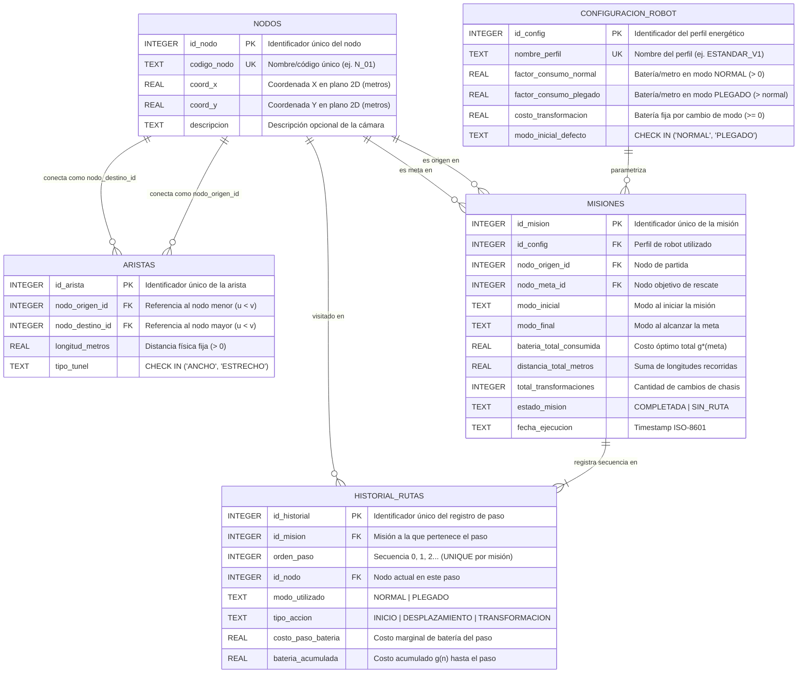

# Reglas de Negocio y Modelo Relacional — RescateBot Subterráneo

## 1. Reglas de Negocio e Invariantes del Dominio

### 1.1 Invariante de Entorno 100% Estático
- **Nodos Inmutables:** Las cámaras o intersecciones del sistema subterráneo poseen coordenadas espaciales 2D $(x, y)$ fijas en metros. No existen desplazamientos tectónicos ni cambios de estado en los nodos.
- **Transformación Libre en Nodos:** El cambio de configuración física del chasis (`NORMAL` $\leftrightarrow$ `PLEGADO`) está permitido en cualquier nodo del grafo.
- **Aristas Bidireccionales Estáticas:** Las conexiones representan un **grafo no dirigido** ($u \leftrightarrow v$). Cada arista posee una `longitud_metros` fija y un `tipo_tunel` (`ANCHO` o `ESTRECHO`). No existen derrumbes dinámicos ni congestión de tráfico.
- **Restricción Física de Navegación:**
  - Túnel `ANCHO`: Transitable en modo `NORMAL` y en modo `PLEGADO`.
  - Grieta `ESTRECHO`: Transitable **exclusivamente** en modo `PLEGADO`.
- **Invariante Geométrico para Admisibilidad de $h(n)$:** Para cualquier arista entre los nodos $u(x_u, y_u)$ y $v(x_v, y_v)$, la longitud física del túnel satisface la desigualdad geométrica respecto a la distancia euclidiana en línea recta:
  $$\text{longitud\_metros}(u, v) \ge \sqrt{(x_u - x_v)^2 + (y_u - y_v)^2}$$

### 1.2 Modelo de Costos Energéticos (Batería)
- **Desplazamiento en Modo Normal:** $\text{Costo} = \text{longitud\_metros} \times \text{factor\_consumo\_normal}$
- **Desplazamiento en Modo Plegado:** $\text{Costo} = \text{longitud\_metros} \times \text{factor\_consumo\_plegado}$, donde $\text{factor\_consumo\_plegado} > \text{factor\_consumo\_normal} > 0$.
- **Transformación de Chasis:** $\text{Costo} = \text{costo\_transformacion} \ge 0$ (costo fijo por conmutar entre `NORMAL` y `PLEGADO` dentro de un nodo).

---

## 2. Diagrama Entidad-Relación (Mermaid)



---

## 3. Propuesta de Esquema DDL (SQLite 3)

```sql
-- Habilitar integridad referencial en SQLite
PRAGMA foreign_keys = ON;

-- =========================================================================
-- 1. ENTIDADES ESTÁTICAS TOPOLÓGICAS Y PARAMÉTRICAS
-- =========================================================================

CREATE TABLE IF NOT EXISTS nodos (
    id_nodo INTEGER PRIMARY KEY,
    codigo_nodo TEXT NOT NULL UNIQUE,
    coord_x REAL NOT NULL,
    coord_y REAL NOT NULL,
    descripcion TEXT
);

CREATE TABLE IF NOT EXISTS aristas (
    id_arista INTEGER PRIMARY KEY AUTOINCREMENT,
    nodo_origen_id INTEGER NOT NULL,
    nodo_destino_id INTEGER NOT NULL,
    longitud_metros REAL NOT NULL CHECK (longitud_metros > 0.0),
    tipo_tunel TEXT NOT NULL CHECK (tipo_tunel IN ('ANCHO', 'ESTRECHO')),
    -- Prevención de bucles y duplicados simétricos en grafo no dirigido
    CONSTRAINT chk_orden_canonico CHECK (nodo_origen_id < nodo_destino_id),
    CONSTRAINT uq_arista_no_dirigida UNIQUE (nodo_origen_id, nodo_destino_id),
    FOREIGN KEY (nodo_origen_id) REFERENCES nodos(id_nodo) ON DELETE RESTRICT,
    FOREIGN KEY (nodo_destino_id) REFERENCES nodos(id_nodo) ON DELETE RESTRICT
);

CREATE TABLE IF NOT EXISTS configuracion_robot (
    id_config INTEGER PRIMARY KEY AUTOINCREMENT,
    nombre_perfil TEXT NOT NULL UNIQUE,
    factor_consumo_normal REAL NOT NULL CHECK (factor_consumo_normal > 0.0),
    factor_consumo_plegado REAL NOT NULL CHECK (factor_consumo_plegado > factor_consumo_normal),
    costo_transformacion REAL NOT NULL CHECK (costo_transformacion >= 0.0),
    modo_inicial_defecto TEXT NOT NULL DEFAULT 'NORMAL' CHECK (modo_inicial_defecto IN ('NORMAL', 'PLEGADO'))
);

-- =========================================================================
-- 2. ENTIDADES TRANSACCIONALES (AUDITORÍA Y TRAZABILIDAD DE MISIONES A*)
-- =========================================================================

CREATE TABLE IF NOT EXISTS misiones (
    id_mision INTEGER PRIMARY KEY AUTOINCREMENT,
    id_config INTEGER NOT NULL,
    nodo_origen_id INTEGER NOT NULL,
    nodo_meta_id INTEGER NOT NULL,
    modo_inicial TEXT NOT NULL DEFAULT 'NORMAL' CHECK (modo_inicial IN ('NORMAL', 'PLEGADO')),
    modo_final TEXT CHECK (modo_final IN ('NORMAL', 'PLEGADO')),
    bateria_total_consumida REAL NOT NULL DEFAULT 0.0 CHECK (bateria_total_consumida >= 0.0),
    distancia_total_metros REAL NOT NULL DEFAULT 0.0 CHECK (distancia_total_metros >= 0.0),
    total_transformaciones INTEGER NOT NULL DEFAULT 0 CHECK (total_transformaciones >= 0),
    estado_mision TEXT NOT NULL DEFAULT 'COMPLETADA' CHECK (estado_mision IN ('COMPLETADA', 'SIN_RUTA')),
    fecha_ejecucion TEXT NOT NULL DEFAULT (CURRENT_TIMESTAMP),
    FOREIGN KEY (id_config) REFERENCES configuracion_robot(id_config) ON DELETE RESTRICT,
    FOREIGN KEY (nodo_origen_id) REFERENCES nodos(id_nodo) ON DELETE RESTRICT,
    FOREIGN KEY (nodo_meta_id) REFERENCES nodos(id_nodo) ON DELETE RESTRICT
);

CREATE TABLE IF NOT EXISTS historial_rutas (
    id_historial INTEGER PRIMARY KEY AUTOINCREMENT,
    id_mision INTEGER NOT NULL,
    orden_paso INTEGER NOT NULL CHECK (orden_paso >= 0),
    id_nodo INTEGER NOT NULL,
    modo_utilizado TEXT NOT NULL CHECK (modo_utilizado IN ('NORMAL', 'PLEGADO')),
    tipo_accion TEXT NOT NULL CHECK (tipo_accion IN ('INICIO', 'DESPLAZAMIENTO', 'TRANSFORMACION')),
    costo_paso_bateria REAL NOT NULL DEFAULT 0.0 CHECK (costo_paso_bateria >= 0.0),
    bateria_acumulada REAL NOT NULL DEFAULT 0.0 CHECK (bateria_acumulada >= 0.0),
    CONSTRAINT uq_mision_paso UNIQUE (id_mision, orden_paso),
    FOREIGN KEY (id_mision) REFERENCES misiones(id_mision) ON DELETE CASCADE,
    FOREIGN KEY (id_nodo) REFERENCES nodos(id_nodo) ON DELETE RESTRICT
);

-- =========================================================================
-- 3. ÍNDICES DE RENDIMIENTO PARA CARGA DE GRAFO Y CONSULTAS DE AUDITORÍA
-- =========================================================================

CREATE INDEX IF NOT EXISTS idx_aristas_origen ON aristas(nodo_origen_id);
CREATE INDEX IF NOT EXISTS idx_aristas_destino ON aristas(nodo_destino_id);
CREATE INDEX IF NOT EXISTS idx_historial_mision_orden ON historial_rutas(id_mision, orden_paso);
```

