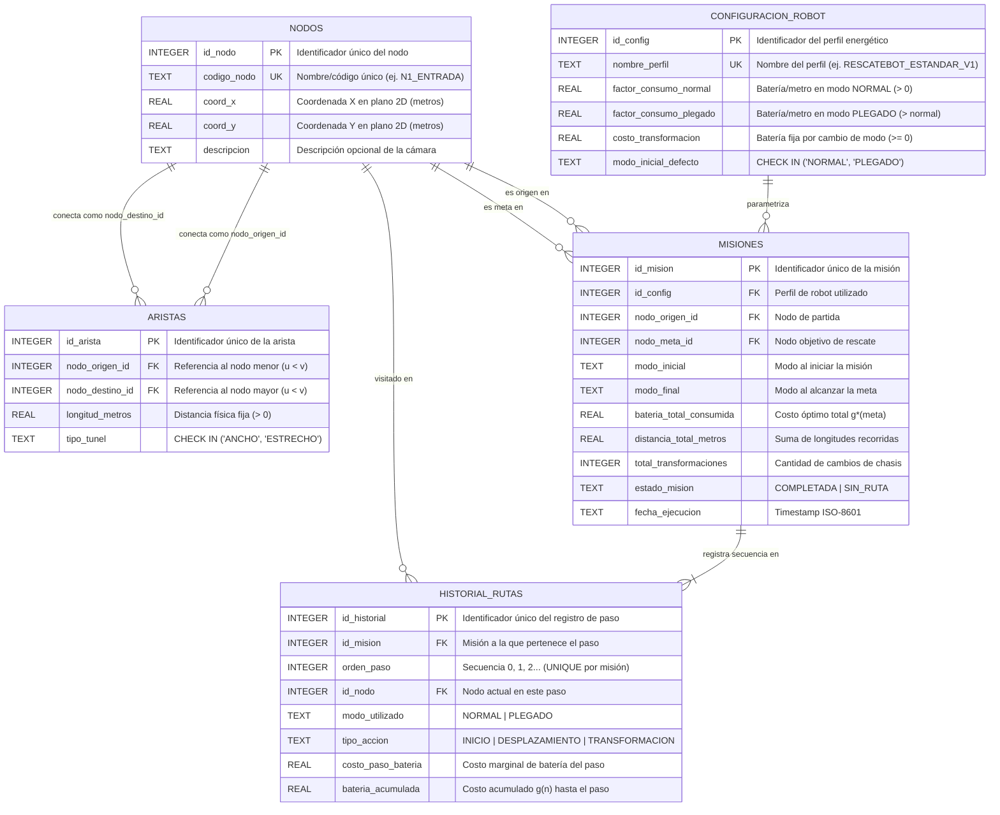
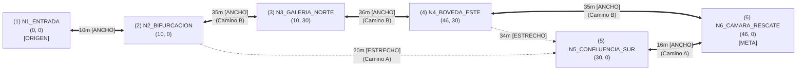
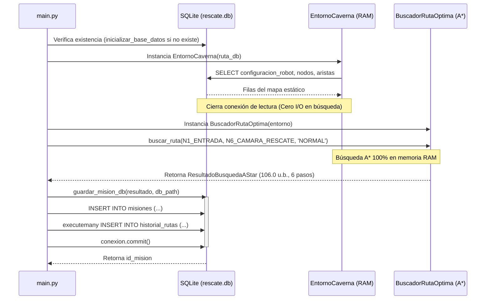

# Reporte Técnico — RescateBot Subterráneo

## 1. Introducción
### 1.1 Propósito del Sistema
**RescateBot Subterráneo** es una solución de backend en Python diseñada para la planificación óptima de rutas de rescate en sistemas de cavernas estáticos. El sistema combina un modelo de persistencia en base de datos relacional embebida (**SQLite 3**) con un motor de búsqueda heurística óptima (**A\***) enfocado en la minimización del consumo energético (batería).

### 1.2 Planteamiento del Problema de Optimización
El entorno subterráneo se representa como un grafo no dirigido y estático donde las cámaras o intersecciones son los vértices (con coordenadas espaciales 2D $(x, y)$ fijas) y los pasajes subterráneos (túneles anchos y grietas estrechas) son las aristas con longitudes físicas constantes. Dado que el robot posee dos estados cinemáticos (**Normal** y **Plegado**) con diferentes tasas de consumo energético por metro y un costo energético fijo por transición de modo (transformación permitida en cualquier nodo), el problema de búsqueda se modela en un grafo de espacio de estados aumentado para garantizar la optimalidad global del consumo de batería.

---

## 2. Modelo de Base de Datos

El sistema de persistencia está diseñado específicamente para **SQLite 3** operando sobre un archivo local `rescate.db` embebido, garantizando cero procesos demonios o servicios de red en segundo plano y cumplimiento estricto de integridad referencial (`PRAGMA foreign_keys = ON`).

El esquema se divide arquitectónicamente en dos capas:
1. **Capa Estática y Paramétrica:** Modela la topología inmutable de las cavernas (`nodos`, `aristas`) y los parámetros físicos del chasis (`configuracion_robot`).
2. **Capa Transaccional de Auditoría:** Registra las ejecuciones de planificación de rescate (`misiones`) y la traza secuencial óptima paso a paso producida por el algoritmo A\* (`historial_rutas`).

### 2.1 Diagrama Entidad-Relación (Conceptual / Lógico)

### 2.2 Diccionario de Datos y Entidades

#### 2.2.1 Tabla `nodos` (Entidad Estática Topológica)
Representa las cámaras o intersecciones del sistema subterráneo donde el robot puede transitar o ejecutar una transformación de chasis.
- `id_nodo` (`INTEGER PRIMARY KEY`): Identificador numérico único del vértice.
- `codigo_nodo` (`TEXT NOT NULL UNIQUE`): Etiqueta identificadora legible (ej. `'N1_ENTRADA'`).
- `coord_x` (`REAL NOT NULL`): Coordenada cartesiana $X$ en metros dentro del plano 2D estático.
- `coord_y` (`REAL NOT NULL`): Coordenada cartesiana $Y$ en metros dentro del plano 2D estático.
- `descripcion` (`TEXT`): Información descriptiva opcional del punto topológico.
- **Rol en el Sistema:** Provee los vértices del grafo y las coordenadas $(x, y)$ requeridas por la función heurística $h(n)$ para el cálculo de la distancia Euclidiana hacia el nodo meta.

#### 2.2.2 Tabla `aristas` (Entidad Estática Topológica)
Representa los pasajes bidireccionales fijos que conectan pares de nodos en la caverna.
- `id_arista` (`INTEGER PRIMARY KEY AUTOINCREMENT`): Identificador único de la conexión.
- `nodo_origen_id` (`INTEGER NOT NULL FK -> nodos.id_nodo`): Primer extremo de la conexión.
- `nodo_destino_id` (`INTEGER NOT NULL FK -> nodos.id_nodo`): Segundo extremo de la conexión.
- `longitud_metros` (`REAL NOT NULL CHECK (longitud_metros > 0.0)`): Distancia física real del pasaje en metros.
- `tipo_tunel` (`TEXT NOT NULL CHECK (tipo_tunel IN ('ANCHO', 'ESTRECHO'))`): Clasificación geométrica del pasaje.
- **Rol en el Sistema:** Define la matriz/lista de adyacencia del grafo estático. Al cargarse en Python, cada fila genera dos transiciones dirigidas simétricas ($u \to v$ y $v \to u$) cuyo costo en batería se evalúa dinámicamente multiplicando `longitud_metros` por el factor del modo activo.

#### 2.2.3 Tabla `configuracion_robot` (Entidad Paramétrica Estática)
Almacena los parámetros físicos y energéticos del RescateBot.
- `id_config` (`INTEGER PRIMARY KEY AUTOINCREMENT`): Identificador único del perfil de configuración.
- `nombre_perfil` (`TEXT NOT NULL UNIQUE`): Nombre descriptivo de la configuración (ej. `'RESCATEBOT_ESTANDAR_V1'`).
- `factor_consumo_normal` (`REAL NOT NULL CHECK (factor_consumo_normal > 0.0)`): Consumo de batería por metro recorrido en modo `NORMAL`.
- `factor_consumo_plegado` (`REAL NOT NULL CHECK (factor_consumo_plegado > factor_consumo_normal)`): Consumo de batería por metro recorrido en modo `PLEGADO`.
- `costo_transformacion` (`REAL NOT NULL CHECK (costo_transformacion >= 0.0)`): Costo fijo de batería consumido cada vez que el robot conmuta entre `NORMAL` y `PLEGADO`.
- `modo_inicial_defecto` (`TEXT NOT NULL DEFAULT 'NORMAL'`): Configuración física por defecto al iniciar una misión.
- **Rol en el Sistema:** Desacopla las constantes físicas del código fuente, permitiendo que la función de costo $g(n)$ y la heurística $h(n)$ consulten los coeficientes energéticos directamente desde la base de datos.

#### 2.2.4 Tabla `misiones` (Entidad Transaccional — Cabecera)
Registra cada solicitud y resultado global de ejecución del algoritmo A\*.
- `id_mision` (`INTEGER PRIMARY KEY AUTOINCREMENT`): Identificador único de la misión de rescate.
- `id_config` (`INTEGER NOT NULL FK -> configuracion_robot.id_config`): Perfil energético empleado en el cálculo.
- `nodo_origen_id` (`INTEGER NOT NULL FK -> nodos.id_nodo`): Nodo de partida de la misión.
- `nodo_meta_id` (`INTEGER NOT NULL FK -> nodos.id_nodo`): Nodo objetivo donde se requiere el rescate.
- `modo_inicial` (`TEXT NOT NULL`): Modo físico inicial del robot (`NORMAL` o `PLEGADO`).
- `modo_final` (`TEXT`): Modo físico en el que el robot arriba a la meta.
- `bateria_total_consumida` (`REAL NOT NULL`): Costo óptimo acumulado final $g^*(\text{meta})$.
- `distancia_total_metros` (`REAL NOT NULL`): Suma de las longitudes físicas de las aristas empleadas en la ruta óptima.
- `total_transformaciones` (`INTEGER NOT NULL`): Número total de cambios de modo ejecutados durante la misión.
- `estado_mision` (`TEXT NOT NULL`): Resultado de la búsqueda (`COMPLETADA` o `SIN_RUTA`).
- `fecha_ejecucion` (`TEXT NOT NULL`): Marca temporal de la ejecución.
- **Rol en el Sistema:** Persiste el resumen ejecutivo y las métricas globales de optimalidad de cada misión calculada.

#### 2.2.5 Tabla `historial_rutas` (Entidad Transaccional — Detalle)
Almacena la secuencia ordenada de estados y acciones que componen la ruta óptima de una misión.
- `id_historial` (`INTEGER PRIMARY KEY AUTOINCREMENT`): Identificador único del paso.
- `id_mision` (`INTEGER NOT NULL FK -> misiones.id_mision ON DELETE CASCADE`): Misión a la que pertenece el paso.
- `orden_paso` (`INTEGER NOT NULL CHECK (orden_paso >= 0)`): Índice secuencial del paso ($0, 1, 2, \dots, k$).
- `id_nodo` (`INTEGER NOT NULL FK -> nodos.id_nodo`): Nodo en el que se encuentra el robot en dicho paso.
- `modo_utilizado` (`TEXT NOT NULL CHECK (modo_utilizado IN ('NORMAL', 'PLEGADO'))`): Estado del chasis en ese paso.
- `tipo_accion` (`TEXT NOT NULL CHECK (tipo_accion IN ('INICIO', 'DESPLAZAMIENTO', 'TRANSFORMACION'))`): Operación ejecutada para alcanzar el estado actual.
- `costo_paso_bateria` (`REAL NOT NULL`): Costo energético marginal $\Delta g$ de la transición ejecutada.
- `bateria_acumulada` (`REAL NOT NULL`): Costo energético acumulado $g(n)$ desde el inicio hasta este paso.
- **Rol en el Sistema:** Provee trazabilidad completa de la solución en el espacio de estados aumentado $(nodo, modo)$, permitiendo auditar exactamente en qué nodo se transformó el robot y cuánta batería consumió cada segmento.

### 2.3 Justificación de Diseño Relacional y Restricciones DDL

1. **Representación Canónica de Grafo No Dirigido (`CHECK (nodo_origen_id < nodo_destino_id)`):**
   En lugar de duplicar filas para representar la bidireccionalidad $(u, v)$ y $(v, u)$, se impone la restricción `CHECK (nodo_origen_id < nodo_destino_id)` combinada con `UNIQUE (nodo_origen_id, nodo_destino_id)`. Esto garantiza en SQLite ausencia de bucles reflexivos ($u = u$), unicidad estricta por par de nodos y simetría al construir la lista de adyacencia en memoria.
2. **Integridad de Dominio Energético (`CHECK (factor_consumo_plegado > factor_consumo_normal)`):**
   Garantiza que `factor_consumo_normal` sea siempre el factor mínimo global de desplazamiento por metro, condición necesaria para la admisibilidad de la heurística euclidiana.
3. **Separación de Acciones en `historial_rutas` (`tipo_accion`):**
   Distingue con precisión entre desplazamientos inter-nodo y transformaciones intra-nodo.

---

### 2.4 Diseño del Mapa Estático de Prueba (`db_setup.py`)

El script `src/db_setup.py` siembra el perfil energético `RESCATEBOT_ESTANDAR_V1` y un grafo estático de **6 nodos** y **7 aristas bidireccionales** diseñado para enfrentar al algoritmo A\* a un dilema no trivial de optimización energética.

#### Parámetros Energéticos Sembrados (`configuracion_robot`)
- **`factor_consumo_normal`**: $1.0\text{ u.b./m}$ (unidades de batería por metro).
- **`factor_consumo_plegado`**: $2.5\text{ u.b./m}$.
- **`costo_transformacion`**: $15.0\text{ u.b.}$ (costo fijo por conmutar `NORMAL` $\leftrightarrow$ `PLEGADO`).
- **`modo_inicial_defecto`**: `'NORMAL'`.

#### Topología del Mapa de Prueba

#### Tabla de Nodos Sembrados y Coordenadas 2D
| `id_nodo` | `codigo_nodo` | `coord_x` (m) | `coord_y` (m) | Distancia Euclidiana a Meta `N6(46, 0)` |
| :---: | :--- | :---: | :---: | :---: |
| **1** | `N1_ENTRADA` | $0.0$ | $0.0$ | $46.00\text{ m}$ |
| **2** | `N2_BIFURCACION` | $10.0$ | $0.0$ | $36.00\text{ m}$ |
| **3** | `N3_GALERIA_NORTE` | $10.0$ | $30.0$ | $46.86\text{ m}$ |
| **4** | `N4_BOVEDA_ESTE` | $46.0$ | $30.0$ | $30.00\text{ m}$ |
| **5** | `N5_CONFLUENCIA_SUR` | $30.0$ | $0.0$ | $16.00\text{ m}$ |
| **6** | `N6_CAMARA_RESCATE` | $46.0$ | $0.0$ | $0.00\text{ m}$ |

#### Tabla de Aristas Sembradas y Verificación de Invariante Geométrico
Todas las aristas satisfacen $\text{longitud\_metros}(u, v) \ge d_{\text{Euclidiana}}(u, v)$ para preservar la admisibilidad y consistencia de $h(n)$:

| Arista $(u, v)$ | `longitud_metros` | $d_{\text{Euclidiana}}(u, v)$ | `tipo_tunel` | Costo en `NORMAL` | Costo en `PLEGADO` |
| :---: | :---: | :---: | :---: | :---: | :---: |
| $(1, 2)$ | $10.0\text{ m}$ | $10.0\text{ m}$ | `ANCHO` | $10.0\text{ u.b.}$ | $25.0\text{ u.b.}$ |
| $(2, 5)$ | $20.0\text{ m}$ | $20.0\text{ m}$ | `ESTRECHO` | *Bloqueado* | $50.0\text{ u.b.}$ |
| $(5, 6)$ | $16.0\text{ m}$ | $16.0\text{ m}$ | `ANCHO` | $16.0\text{ u.b.}$ | $40.0\text{ u.b.}$ |
| $(2, 3)$ | $35.0\text{ m}$ | $30.0\text{ m}$ | `ANCHO` | $35.0\text{ u.b.}$ | $87.5\text{ u.b.}$ |
| $(3, 4)$ | $36.0\text{ m}$ | $36.0\text{ m}$ | `ANCHO` | $36.0\text{ u.b.}$ | $90.0\text{ u.b.}$ |
| $(4, 6)$ | $35.0\text{ m}$ | $30.0\text{ m}$ | `ANCHO` | $35.0\text{ u.b.}$ | $87.5\text{ u.b.}$ |
| $(4, 5)$ | $34.0\text{ m}$ | $34.0\text{ m}$ | `ESTRECHO` | *Bloqueado* | $85.0\text{ u.b.}$ |

#### Análisis Matemático del Dilema de Decisión (Origen `N1` en `NORMAL` $\to$ Meta `N6`)
1. **Camino B (Rodeo 100% ANCHO: $1 \to 2 \to 3 \to 4 \to 6$, sin transformaciones):**
   - El robot permanece en modo `NORMAL` todo el trayecto ($116.0\text{ m}$ totales).
   - $\text{Costo Total} = (10 + 35 + 36 + 35) \times 1.0 = \mathbf{116.0\text{ u.b.}}$
2. **Camino A — Estrategia Ingenua A1 ($1 \to 2 \to 5 \to 6$ con 1 sola transformación):**
   - El robot llega a `N2` ($10\text{ u.b.}$), se pliega en `N2` ($+15\text{ u.b.}$), cruza la grieta estrecha $2 \to 5$ ($20 \times 2.5 = 50\text{ u.b.}$) y continúa en modo `PLEGADO` por el túnel ancho $5 \to 6$ ($16 \times 2.5 = 40\text{ u.b.}$).
   - $\text{Costo Total} = 10 + 15 + 50 + 40 = \mathbf{115.0\text{ u.b.}}$
3. **Camino A — Estrategia Óptima A2 ($1 \to 2 \to 5 \to 6$ con doble transformación táctica):**
   - El robot llega a `N2` en `NORMAL` ($10\text{ u.b.}$), se transforma a `PLEGADO` en `N2` ($+15\text{ u.b.}$), cruza la grieta estrecha $2 \to 5$ ($+50\text{ u.b.}$), **se vuelve a transformar a `NORMAL` en `N5`** ($+15\text{ u.b.}$) y recorre el tramo ancho final $5 \to 6$ en `NORMAL` ($16 \times 1.0 = 16\text{ u.b.}$).
   - $\text{Costo Total} = 10 + 15 + 50 + 15 + 16 = \mathbf{106.0\text{ u.b.}}$ (**ÓPTIMO GLOBAL**).

---

## 3. Documentación del Algoritmo A*

El algoritmo de búsqueda heurística **A\*** se implementa en `src/a_star_solver.py` evaluando la función de prioridad estándar:
$$f(s) = g(s) + h(s)$$
donde $s = (u, m)$ pertenece al espacio de estados aumentado.

### 3.1 Definición del Espacio de Estados Aumentado
Si el problema se modelara únicamente sobre el conjunto de vértices topológicos $V$, el principio de optimalidad de Bellman se violaría: llegar a un nodo $u$ con un costo ligeramente menor en modo `NORMAL` podría descartar llegar a $u$ en modo `PLEGADO`, impidiendo cruzar una grieta estrecha adyacente sin pagar una transformación adicional.

Por ello, se define el **espacio de estados aumentado** $\mathcal{S}$ como el producto cartesiano:
$$\mathcal{S} = V \times M, \quad \text{donde } M = \{\text{'NORMAL'}, \text{'PLEGADO'}\}$$

- **Estado Inicial:** $s_0 = (u_{\text{origen}}, m_{\text{inicial}})$.
- **Conjunto de Estados Meta:** $\mathcal{S}_{\text{meta}} = \{ (u_{\text{meta}}, m) \mid m \in M \}$. La búsqueda finaliza de forma óptima en el instante en que cualquier par $(u_{\text{meta}}, m)$ es extraído de la cima de la cola de prioridad `frontera`.

### 3.2 Función Sucesora y Costo Acumulado $g(s)$

Para cualquier estado actual $s = (u, m) \in \mathcal{S}$, la función sucesora $\text{Expandir}(u, m)$ genera dos familias de transiciones dirigidas en el grafo de estados:

1. **Transiciones de Desplazamiento Inter-Nodo $(u, m) \to (v, m)$:**
   Para cada arista incidente $e = (u, v)$ con longitud $L(u, v) > 0$ y tipo de túnel $\tau(u, v) \in \{\text{'ANCHO'}, \text{'ESTRECHO'}\}$:
   - **Condición de factibilidad física:**
     $$\text{Transitable}(\tau, m) \iff (\tau = \text{'ANCHO'}) \lor (\tau = \text{'ESTRECHO'} \land m = \text{'PLEGADO'})$$
   - **Costo marginal del paso ($\Delta g$):**
     $$c\big((u, m) \to (v, m)\big) = L(u, v) \cdot \alpha(m)$$
     donde $\alpha(\text{'NORMAL'}) = \text{factor\_consumo\_normal}$ y $\alpha(\text{'PLEGADO'}) = \text{factor\_consumo\_plegado}$.

2. **Transición de Transformación Intra-Nodo $(u, m) \to (u, \bar{m})$:**
   En cualquier nodo $u \in V$, el robot siempre puede conmutar su modo físico al opuesto $\bar{m}$ sin cambiar de posición espacial ($L = 0$):
   $$c\big((u, m) \to (u, \bar{m})\big) = C_{\text{transf}} = \text{costo\_transformacion} \ge 0$$

El **costo acumulado** $g(s)$ de una trayectoria $s_0 \to s_1 \to \dots \to s_k = s$ es la suma exacta de los costos marginales:
$$g(s_k) = \sum_{i=0}^{k-1} c(s_i \to s_{i+1})$$

### 3.3 Función Heurística $h(s)$: Demostración de Admisibilidad y Consistencia

La función heurística implementada en `calcular_heuristica(estado_actual, nodo_meta_id)` estima el costo energético mínimo remanente desde cualquier estado $s = (u, m)$ hasta el nodo meta $u_{\text{meta}}$ mediante la expresión:
$$h(u, m) = d_{\text{Euclidiana}}(u, u_{\text{meta}}) \cdot \alpha(\text{'NORMAL'})$$
donde:
$$d_{\text{Euclidiana}}(u, u_{\text{meta}}) = \sqrt{(x_{\text{meta}} - x_u)^2 + (y_{\text{meta}} - y_u)^2}$$

#### Demostración de Admisibilidad ($0 \le h(s) \le h^*(s)$)
Sea $\pi^* = (s_0, s_1, \dots, s_p)$ el camino óptimo real en el espacio de estados desde $s = (u, m)$ hasta alcanzar $u_{\text{meta}}$, con costo verdadero $h^*(s)$. El camino $\pi^*$ consta de un subconjunto de pasos de desplazamiento sobre aristas físicas $\{e_1, e_2, \dots, e_r\}$ y $q \ge 0$ transformaciones de chasis:
$$h^*(s) = \sum_{j=1}^{r} L(e_j) \cdot \alpha(m_j) + q \cdot C_{\text{transf}}$$

Analizando cada término:
1. **Cota de Transformación:** Como $q \ge 0$ y $C_{\text{transf}} \ge 0$, se cumple que $q \cdot C_{\text{transf}} \ge 0$.
2. **Cota Frente a Túneles Estrechos (`ESTRECHO`):** Por restricción de dominio en la base de datos, $\alpha(\text{'PLEGADO'}) > \alpha(\text{'NORMAL'}) > 0$. Incluso si la ruta óptima cruza túneles estrechos (donde obligatoriamente $m_j = \text{'PLEGADO'}$), para todo tramo $j$ se satisface:
   $$\alpha(m_j) \ge \min_{m \in M} \alpha(m) = \alpha(\text{'NORMAL'})$$
3. **Cota Geométrica Euclidiana:** Por la desigualdad triangular en $\mathbb{R}^2$ y el invariante físico $L(e_j) \ge d_{\text{Euclidiana}}(u_j, v_j)$, la longitud total recorrida por cualquier secuencia de túneles entre $u$ y $u_{\text{meta}}$ cumple:
   $$\sum_{j=1}^{r} L(e_j) \ge \sum_{j=1}^{r} d_{\text{Euclidiana}}(u_j, v_j) \ge d_{\text{Euclidiana}}(u, u_{\text{meta}})$$

Combinando las tres desigualdades:
$$h^*(s) \ge \sum_{j=1}^{r} L(e_j) \cdot \alpha(\text{'NORMAL'}) + 0 \ge d_{\text{Euclidiana}}(u, u_{\text{meta}}) \cdot \alpha(\text{'NORMAL'}) = h(s)$$
Por lo tanto, **$h(s) \le h^*(s)$ para todo $s \in \mathcal{S}$**, demostrando que la heurística es **estrictamente admisible**.

#### Demostración de Consistencia / Monotonicidad ($h(s) \le c(s \to s') + h(s')$)
- **Caso 1 (Transformación en el mismo nodo $s=(u, m) \to s'=(u, \bar{m})$):**
  Como $h(u, m)$ depende únicamente de las coordenadas espaciales de $u$, tenemos $h(s) = h(s')$. Dado que $c(s \to s') = C_{\text{transf}} \ge 0$, se cumple trivialmente $h(s) \le C_{\text{transf}} + h(s')$.
- **Caso 2 (Desplazamiento entre nodos $s=(u, m) \to s'=(v, m)$):**
  Por desigualdad triangular euclidiana:
  $$d_{\text{Euclidiana}}(u, u_{\text{meta}}) \le d_{\text{Euclidiana}}(u, v) + d_{\text{Euclidiana}}(v, u_{\text{meta}}) \le L(u, v) + d_{\text{Euclidiana}}(v, u_{\text{meta}})$$
  Multiplicando por $\alpha(\text{'NORMAL'}) > 0$ y usando que $\alpha(\text{'NORMAL'}) \le \alpha(m)$:
  $$h(u, m) \le L(u, v) \cdot \alpha(\text{'NORMAL'}) + h(v, m) \le L(u, v) \cdot \alpha(m) + h(v, m) = c(s \to s') + h(s')$$

Al ser **consistente**, los valores $f(s)$ a lo largo de cualquier camino son monótonamente no decrecientes y la primera extracción del nodo meta desde la cola de prioridad garantiza optimalidad global sin necesidad de reabrir estados subóptimos.

---

### 3.4 Arquitectura de Clases y Funciones (`/src/`)

#### 3.4.1 Módulo `src/db_setup.py`
Encargado de la creación física del archivo SQLite (`rescate.db`), ejecución del esquema DDL e inserción idempotente de datos semilla.
- **`crear_esquema(conexion: sqlite3.Connection) -> None`**: Ejecuta el bloque `DDL_ESQUEMA_SQLITE` activando `PRAGMA foreign_keys = ON` y creando las 5 tablas e índices del modelo relacional.
- **`sembrar_datos_iniciales(conexion: sqlite3.Connection) -> None`**: Limpia registros previos de forma ordenada e inserta el perfil energético `RESCATEBOT_ESTANDAR_V1`, los 6 nodos con coordenadas 2D y las 7 aristas canónicas del mapa de prueba.
- **`inicializar_base_datos(ruta_db: Optional[Union[str, Path]] = None) -> Path`**: Función fachada que gestiona el contexto de conexión a `rescate.db`, invoca `crear_esquema` y `sembrar_datos_iniciales`, y retorna la ruta absoluta de la base de datos inicializada.

#### 3.4.2 Módulo `src/rescate_bot.py` (Estructuras Base y Entorno en RAM)
Define las abstracciones inmutables del espacio de estados y el cargador de topología en memoria RAM.
- **Clase `EstadoRobot(id_nodo: int, modo: str = 'NORMAL')` (`@dataclass(frozen=True, order=True)`)**:
  - Encapsula el estado compuesto $(u, m)$. Implementa `__hash__`, `__eq__` y `__lt__` para operar como clave en el diccionario `costo_acumulado` y ordenarse determinísticamente en `heapq`.
  - Métodos: `modo_opuesto() -> str`, `transformar() -> EstadoRobot`.
- **Clases de Datos Auxiliares (`@dataclass(frozen=True)`)**:
  - `NodoCaverna(id_nodo, codigo_nodo, coord_x, coord_y, descripcion)`
  - `ConexionTunel(id_arista, nodo_vecino_id, longitud_metros, tipo_tunel)`
  - `ConfiguracionEnergetica(id_config, nombre_perfil, factor_consumo_normal, factor_consumo_plegado, costo_transformacion, modo_inicial_defecto)`
- **Clase `EntornoCaverna`**:
  - Carga toda la topología estática en memoria RAM (`self.nodos` y `self.adyacencia`) y cierra la conexión SQLite.
  - Métodos: `cargar_desde_sqlite()`, `obtener_nodo(id_nodo)`, `obtener_coordenadas(id_nodo)`, `obtener_vecinos(id_nodo)`, `es_tunel_transitable(tipo_tunel, modo_actual)`.

#### 3.4.3 Módulo `src/a_star_solver.py` (Motor de Búsqueda Heurística Óptima A\*)
Contiene las estructuras de transición/resultado y el solucionador A\*.
- **Clase `TransicionEstado(estado_siguiente, costo_paso, tipo_accion, longitud_metros)` (`@dataclass(frozen=True)`)**: Representa una transición válida generada por `expandir_estado`.
- **Clase `PasoRutaOptima(orden_paso, estado, tipo_accion, costo_paso_bateria, bateria_acumulada, distancia_paso_metros)` (`@dataclass(frozen=True)`)**: Modela cada eslabón de la ruta óptima reconstruida, alineado con la tabla `historial_rutas`.
- **Clase `ResultadoBusquedaAStar(...)` (`@dataclass(frozen=True)`)**: Empaqueta el resultado integral de `buscar_ruta`.
- **Clase `BuscadorRutaOptima`**:
  - `calcular_heuristica(self, estado_actual, nodo_meta_id) -> float`
  - `expandir_estado(self, estado_actual) -> List[TransicionEstado]`
  - `buscar_ruta(self, nodo_origen_id, nodo_meta_id, modo_inicial='NORMAL') -> ResultadoBusquedaAStar`
  - `_reconstruir_ruta(estado_inicial, estado_meta, vino_de) -> List[PasoRutaOptima]`

---

## 4. Orquestación y Persistencia de Resultados (`src/main.py`)

El módulo `src/main.py` constituye el punto de entrada del backend y coordina el ciclo de vida completo de una misión de rescate en tres fases desacopladas (Lectura en RAM $\to$ Optimización A\* en CPU $\to$ Escritura Transaccional en SQLite).

### 4.1 Diagrama de Secuencia del Flujo de Orquestación

### 4.2 Documentación de Funciones de `src/main.py`

- **`resolver_id_nodo_por_codigo(entorno: EntornoCaverna, codigo_nodo: str) -> int`**:
  - **Propósito:** Resuelve en memoria RAM el identificador numérico primario (`id_nodo`) a partir del nombre simbólico de la cámara (`'N1_ENTRADA'` $\to 1$, `'N6_CAMARA_RESCATE'` $\to 6$).
- **`guardar_mision_db(resultado: ResultadoBusquedaAStar, db_path: Union[str, Path], id_config: int = 1) -> int`**:
  - **Propósito:** Abre una transacción contra `rescate.db` con `PRAGMA foreign_keys = ON`, inserta el registro maestro en la tabla `misiones` (almacenando `bateria_total_consumida`, `distancia_total_metros`, `total_transformaciones`, `modo_inicial`, `modo_final` y `estado_mision`), recupera el `id_mision` autogenerado (`cursor.lastrowid`), inserta en lote todos los pasos de `resultado.pasos_ruta` en `historial_rutas` mediante `cursor.executemany(...)` y ejecuta explícitamente `conexion.commit()`.
- **`mostrar_reporte_consola(resultado: ResultadoBusquedaAStar, entorno: EntornoCaverna, id_mision: int) -> None`**:
  - **Propósito:** Presenta una tabla formateada con las métricas globales de la misión y el desglose paso a paso (`orden_paso`, `nodo`, `modo_utilizado`, `tipo_accion`, `costo_paso_bateria` y `bateria_acumulada`).
- **`ejecutar_mision_rescate(ruta_db: Optional[Union[str, Path]] = None) -> Tuple[int, ResultadoBusquedaAStar]`**:
  - **Propósito:** Orquesta de principio a fin la inicialización del entorno, la resolución de la ruta óptima entre `N1_ENTRADA` y `N6_CAMARA_RESCATE` comenzando en modo `NORMAL`, y su persistencia en base de datos.

### 4.3 Traza Exacta Esperada en `historial_rutas` para la Misión Semilla

Al ejecutarse `main.py` sobre el mapa estático de prueba, la secuencia óptima persistida en `historial_rutas` corresponde a la **Estrategia A2** ($106.0\text{ u.b.}$):

| `orden_paso` | `id_nodo` (`codigo_nodo`) | `modo_utilizado` | `tipo_accion` | `costo_paso_bateria` ($\Delta g$) | `bateria_acumulada` ($g$) |
| :---: | :--- | :---: | :---: | :---: | :---: |
| **0** | `1` (`N1_ENTRADA`) | `NORMAL` | `INICIO` | $0.00$ | $0.00$ |
| **1** | `2` (`N2_BIFURCACION`) | `NORMAL` | `DESPLAZAMIENTO` | $10.00$ | $10.00$ |
| **2** | `2` (`N2_BIFURCACION`) | `PLEGADO` | `TRANSFORMACION` | $15.00$ | $25.00$ |
| **3** | `5` (`N5_CONFLUENCIA_SUR`) | `PLEGADO` | `DESPLAZAMIENTO` | $50.00$ | $75.00$ |
| **4** | `5` (`N5_CONFLUENCIA_SUR`) | `NORMAL` | `TRANSFORMACION` | $15.00$ | $90.00$ |
| **5** | `6` (`N6_CAMARA_RESCATE`) | `NORMAL` | `DESPLAZAMIENTO` | $16.00$ | **$106.00$** |
